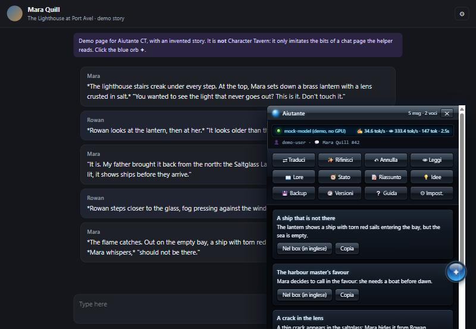

<p align="center"></p>

<h1 align="center">Aiutante CT</h1>

<p align="center">
  <b>Una pulsantiera con IA locale per le chat di <a href="https://character-tavern.com">Character Tavern</a>.</b><br>
  Traduce e rifinisce i tuoi messaggi, tiene aggiornato il lorebook (con versioni e ripristino), lo stato della scena,
  i riassunti e le idee, tutto con un modello che gira sul <i>tuo</i> PC.
</p>

<p align="center"><a href="README.md">🇬🇧 English README</a></p>

<p align="center"></p>
<p align="center"><sub>Il pannello sulla <a href="demo/">pagina di prova</a> (storia inventata, non il sito vero).</sub></p>

> **Non e' un progetto ufficiale di Character Tavern.** E' un progetto indipendente di un appassionato.

## Cosa fa

Nella pagina della chat compare una sfera lucida ✦ (si', e' il tasto Play di Windows Media Player 11). Un clic apre un
pannello di vetro stile Vista con dodici pulsanti:

| Pulsante | Cosa fa |
|---|---|
| ⇄ **Traduci** | Quello che scrivi nella tua lingua diventa inglese corretto, nello stile della storia. Anche <kbd>Ctrl</kbd>+<kbd>Alt</kbd>+<kbd>T</kbd> |
| ✨ **Rifinisci** | Stesse azioni, scritte meglio |
| ↶ **Annulla** | Rimette nel box il testo di prima |
| 👁 **Leggi** | L'ultima risposta del personaggio, nella tua lingua |
| 📖 **Lore** | Propone voci nuove o aggiornate del lorebook; le correggi e premi "Inserisci / Aggiorna in CT" |
| 🧭 **Stato** | La voce "Current State": luogo, chi c'e', oggetti, fili aperti |
| 📝 **Riassunto** | Il riassunto per *Settings → Memory*, piu' i tuoi **📌 fatti fissi** che non si perdono mai |
| 💡 **Idee** | Cinque spunti per il seguito; un clic trasforma un'idea nel tuo prossimo messaggio |
| 💾 **Backup** · 🕘 **Versioni** | Copie del lorebook: confronta con adesso e **ripristina** una voce |
| ❔ **Guida** · ⚙ **Impost.** | Guida interna; lingua, indirizzo del server, chiave per lo smartphone |

**Il lorebook e' protetto:** prima di cambiare una voce l'aiutante ne salva sempre una copia, e le voci scritte da te
(🔒) si sostituiscono solo dopo una tua conferma.

## Regole di Character Tavern

I termini del sito vietano bot e accesso automatizzato. L'aiutante e' fatto apposta per restarne fuori:
**ogni azione parte da un tuo clic** e passa dai **pulsanti normali del sito**, a passo umano; **nessuna chiamata alle
API interne**, niente cicli, niente in background. La chat si legge dalla pagina che hai gia' aperto (e, quando premi
un pulsante, rileggendo quella stessa pagina come un F5). L'unica cosa interrogata di continuo e' il **tuo** server locale.

## Privacy

Tutto resta sul tuo computer: lo script parla solo con `127.0.0.1`, il server solo con il tuo modello. Niente account,
niente statistiche, niente cloud. L'accesso dallo smartphone e' **spento di base** e, se lo accendi, serve una chiave
casuale creata al primo avvio (`data/key.txt`).

## Installazione

1. **Windows:** scarica il progetto (**Code → Download ZIP**), scompattalo, doppio clic su **`SETUP.bat`**: scegli la
   scheda video (AMD/Intel → Vulkan, NVIDIA → CUDA) e il modello. Scarica llama.cpp e il modello in questa cartella e
   **controlla l'impronta SHA-256 di ogni file** ([`scripts/downloads.json`](scripts/downloads.json)).
   Poi **`START.bat`** per accendere e **`STOP.bat`** per spegnere.
   **Linux / macOS:** `sh scripts/unix/setup.sh`, poi `sh scripts/unix/start.sh`.
2. Installa **Tampermonkey** (Chrome/Edge) o **Violentmonkey** (Firefox/LibreWolf). Su Chrome recente:
   `chrome://extensions` → Tampermonkey → Dettagli → **Consenti script utente**.
3. Ad aiutante acceso apri **<http://127.0.0.1:8433/aiutante-ct.user.js>** e premi **Installa** (oppure da [Greasy Fork](https://greasyfork.org/scripts/600563)).
4. Apri una chat su Character Tavern e clicca la sfera blu.

Serve una scheda video da **16 GB** per il modello consigliato (Gemma 4 26B-A4B heretic, 14 GB); con 8-12 GB ci sono
modelli piu' leggeri. Tutti i dettagli (requisiti, smartphone, modelli, FAQ) sono nel [README inglese](README.md).

## Provalo senza scheda video

```bash
python demo/serve.py
```

Apre una chat finta con il pannello, un motore finto e il server in modalita' prova (aggiungi `&lang=it` all'indirizzo).

## Piccole sorprese

Il pannello e' una lettera d'amore al 2007: ci sono un po' di easter egg (guarda il display mentre lavora, prova un
vecchio codice da videogiocatori, clicca veloce la sfera e il logo, passa il mouse sulle cose, soprattutto il 30 gennaio).
Stanno solo dentro il pannello, non toccano il sito e si spengono da ⚙ Impost.

## Licenza

[MIT](LICENSE). Motore e modelli scaricati hanno le loro licenze. "Windows", "Windows Media Player" e "Windows Vista"
sono marchi di Microsoft: qui c'e' solo un omaggio al loro stile.
