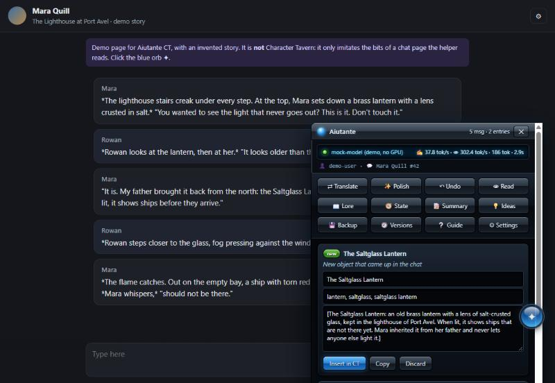

<p align="center"></p>

<h1 align="center">Aiutante CT</h1>

<p align="center">
  <b>A local-AI button bar for <a href="https://character-tavern.com">Character Tavern</a> chats.</b><br>
  Translate and polish your messages, keep the lorebook up to date (with versions and restore), track the current state,
  write summaries and get ideas, all with a model running on <i>your own PC</i>.
</p>

<p align="center">
  <a href="LICENSE"></a>
  
  
  
</p>

<p align="center"><a href="README.it.md">🇮🇹 Leggimi in italiano</a></p>

<p align="center"></p>
<p align="center"><sub>The panel on the <a href="demo/">demo page</a> (an invented story, not the real site).</sub></p>

> **Not affiliated with Character Tavern.** This is an independent, unofficial fan project.

---

## What it does

A glossy orb ✦ (yes, it is the Windows Media Player 11 Play button) sits on every Character Tavern chat page.
Click it and a Vista-style glass panel opens with twelve buttons:

| Button | What it does |
|---|---|
| ⇄ **Translate** | What you typed in your language becomes proper English, in the story's style. Also <kbd>Ctrl</kbd>+<kbd>Alt</kbd>+<kbd>T</kbd> |
| ✨ **Polish** | Better prose for your message: same actions, better written |
| ↶ **Undo** | Puts the previous text back in the box |
| 👁 **Read** | The character's last reply, translated into your language |
| 📖 **Lore** | Proposes new or updated lorebook entries. Edit them, then "Insert / Update in CT" |
| 🧭 **State** | Writes a "Current State" entry: place, who is there, items, open threads |
| 📝 **Summary** | A summary for *Settings → Memory*, plus your own **📌 permanent facts** that never get lost |
| 💡 **Ideas** | Five ideas for what comes next; one click turns an idea into your next message |
| 💾 **Backup** | Saves a copy of the chat's whole lorebook |
| 🕘 **Versions** | Saved copies: compare with now and **restore** a single entry |
| ❔ **Guide** · ⚙ **Settings** | Built-in help; language, server address, phone key |

**Your lorebook is protected.** Before changing an existing entry the helper always saves a copy. Entries you wrote
yourself (🔒) are replaced only after you tick "I have read the current version".

**Long stories.** Tested up to 175 messages (~100,000 tokens, well beyond the model's context): with Summary + permanent
facts + lorebook + Current State, the site's bot still remembered details from the first messages.
Good rhythm: 🧭 State every 10-15 messages, 📝 Summary every 25-30 (and *read it* before pasting it).

## Fair play with Character Tavern's Terms

Character Tavern's terms forbid bots and automated access. Aiutante CT is designed around that:

- **Every action starts from your click** and goes through the site's **normal buttons**, at human pace, exactly as you
  would do it (e.g. *Settings → Lorebooks → Add Entry → Create Entry*). With "save by itself" off, it only fills the form
  and you press the button.
- **No internal API calls** (`/api/...`), no loops, nothing in the background on the site.
- The chat is read from the page you already have open; when you press a button it re-reads that same page once
  (the same request as pressing F5).
- The only thing polled is **your own local server**, for the status light.

You are responsible for how you use it. If the site's rules change, the rules win: please open an issue.

## Privacy

Everything stays on your computer. The userscript talks only to `127.0.0.1` (your PC); the server talks only to your
local model. No accounts, no telemetry, no cloud. History, versions and summaries are plain files in `data/`.
Phone access is **off by default**; when you turn it on, other devices need a random key created on the first start.

## Requirements

| | Minimum | Recommended |
|---|---|---|
| GPU | 8 GB VRAM (12B model) | **16 GB VRAM** (AMD Radeon VII / RX 6800+, NVIDIA RTX 4060 Ti 16 GB / 4080 / 3090…) |
| RAM | 16 GB | 32 GB |
| Disk | 10 GB | 20 GB |
| OS | Windows 10/11, Linux, macOS (Apple Silicon) | |
| Browser | Chrome/Edge/Brave with **Tampermonkey**, or Firefox/LibreWolf with **Violentmonkey** | |

No GPU? It runs on the CPU too, just slowly. Already running LM Studio, KoboldCPP, Ollama or your own `llama-server`?
Point the helper at it (see [docs/CONFIG.md](docs/CONFIG.md)) and skip the model download.

**Measured on a Radeon VII 16 GB** with the recommended model, chat of ~80-95K characters:
Translate/Polish 5-8 s · Read ~13 s · State ~35 s · Ideas ~55 s · Summary ~2.5 min · Lore ~3-4 min.

## Install

### 1. The local part (once)

**Windows**

1. Download this repository (**Code → Download ZIP**) and unzip it, e.g. in `C:\AiutanteCT`.
2. Double-click **`SETUP.bat`**. It asks for your graphics card (AMD/Intel → *Vulkan*, NVIDIA → *CUDA*) and the model,
   then downloads [llama.cpp](https://github.com/ggml-org/llama.cpp) and the model into this folder.
   **Every file is checked against the SHA-256 in [`scripts/downloads.json`](scripts/downloads.json)**; a mismatch is deleted.
   If you have no Python, the official embeddable Python (11 MB, hash-checked too) is put in `python\`.
3. Double-click **`START.bat`**. After 20-60 s it says *Aiutante CT is ON* and a blue orb appears next to the clock.
   **`STOP.bat`** frees the graphics card.

**Linux / macOS**

```bash
git clone https://github.com/4ngryDuck/aiutante-ct.git && cd aiutante-ct
sh scripts/unix/setup.sh      # needs python3 >= 3.9; Vulkan or CUDA on Linux, Metal on macOS
sh scripts/unix/start.sh      # stop: sh scripts/unix/stop.sh
```

On Linux with Vulkan, install your distro's Vulkan driver (`mesa-vulkan-drivers` or the NVIDIA driver). On macOS the
Metal build is used automatically.

**Models** (pick one in setup, change it any time in `server/config.json`):

| Model | Size | VRAM | Notes |
|---|---|---|---|
| [Gemma 4 26B-A4B it heretic](https://huggingface.co/mradermacher/gemma-4-26B-A4B-it-heretic-GGUF) IQ4_XS | 14.1 GB | 16 GB | **Recommended.** MoE: fast, follows instructions, writes good JSON, does not refuse fiction |
| same, Q3_K_S | 12.2 GB | 12-16 GB | for 12 GB cards |
| [MN-Violet-Lotus 12B](https://huggingface.co/mradermacher/MN-Violet-Lotus-12B-GGUF) Q4_K_M | 7.5 GB | 8-10 GB | lighter, weaker on long chats |

"Heretic" models have had their refusals removed, so they help with adult fiction instead of lecturing. They are
third-party models with their own licenses; read their pages.

### 2. The userscript (once per browser)

1. Install **Tampermonkey** (Chrome, Edge, Brave) or **Violentmonkey** (Firefox, LibreWolf).
   On recent Chrome: `chrome://extensions` → Tampermonkey → *Details* → enable **Allow user scripts**.
2. With the helper ON, open **<http://127.0.0.1:8433/aiutante-ct.user.js>** and press **Install**.
   Updates then come from your own PC whenever you update this folder. (Also available on Greasy Fork, see below.)
3. Open a chat on Character Tavern and click the blue orb ✦. If Tampermonkey asks whether the script may connect to
   `127.0.0.1`, choose **Always allow**.

### Phone (optional)

Use the panel from a phone on the same Wi-Fi (or over [Tailscale](https://tailscale.com)):

1. In `server/config.json` set `"network": {"enabled": true, "addresses": ["192.168.1.20"]}` with **this PC's** address.
2. Windows: run `scripts\windows\open-firewall.ps1` (opens the port to your local network and Tailscale only).
3. On the phone (Firefox for Android + Violentmonkey, or Kiwi/Edge + Tampermonkey) open
   `http://192.168.1.20:8433/aiutante-ct.user.js`, install, then put the key from `data/key.txt` in ⚙ Settings.

## Try it without a GPU (and without Character Tavern)

```bash
python demo/serve.py
```

Opens a fake chat page (an invented story) with the panel on it, a **mock engine** with canned answers and the helper
server in demo mode. Add `&lang=it` to the address for the Italian panel. Great for screenshots and for hacking on the UI.

## Little surprises

The panel is a love letter to 2007. There are a few easter eggs; here are some hints, the rest is for you to find:

- Watch the display while a job runs.
- Old-school gamers know a certain code. Try it with the panel open.
- The orb likes being clicked quickly. The logo in the title bar likes it even more.
- Hover over things. Especially in ⚙ Settings, and especially on 30 January.

They live only inside the panel, never touch the site, stay still if your system asks for reduced motion, and can be
switched off in ⚙ Settings → *Visualizations and little surprises*.

## How it works

```
 Character Tavern tab                          your PC
┌──────────────────────┐   your click   ┌────────────────────┐   OpenAI-compatible   ┌──────────────────┐
│ userscript (panel)   │ ─────────────▶ │ server/server.py   │ ────────────────────▶ │ llama-server     │
│ reads the chat page  │ ◀───────────── │ 127.0.0.1:8433     │ ◀──────────────────── │ + your .gguf     │
│ fills forms via the  │    result      │ prompts/, data/    │                       │ 127.0.0.1:8434   │
│ site's own buttons   │                └────────────────────┘                       └──────────────────┘
└──────────────────────┘
```

- `userscript/aiutante-ct.user.js` — the panel (shadow DOM, so the site's styles and the panel never mix).
- `server/server.py` — Python standard library only, no `pip install`. One prompt per button in `server/prompts/`.
  Long jobs run in the background; reloading the page mid-job picks the result up again.
- Every model call is "fresh": the model remembers nothing; memory lives in the site, the panel and `data/`.

## FAQ

**Will this get me banned?** It is built to behave like you: clicks on the site's own buttons, no API calls, no
automation. But it is your account and your responsibility; read the site's terms.

**"page element not found"?** The site changed its look and a lorebook button moved. Translation, summaries and ideas
keep working. Please [open an issue](https://github.com/4ngryDuck/aiutante-ct/issues).

**The display says ⚠ slow.** The graphics card is full and part of the model went to normal RAM (10-20× slower).
Close games, other models or GPU-hungry browser tabs, then STOP and START.

**Can I use a cloud API instead?** The server speaks the OpenAI chat format, so technically yes, but then your chats
leave your PC. The project is about staying local, so this is not documented on purpose.

**Why are the buttons' internal names Italian?** The project was born in Italian. The interface speaks English and
Italian; more languages are welcome (see [CONTRIBUTING](CONTRIBUTING.md)).

**Greasy Fork or local install?** Both work. The local copy (`http://127.0.0.1:8433/aiutante-ct.user.js`) updates
from your PC and always matches your server; the Greasy Fork copy updates from Greasy Fork. Do not install both.

## Contributing

Bug reports, translations and fixes for site changes are very welcome: see [CONTRIBUTING.md](CONTRIBUTING.md).

## License

[MIT](LICENSE). The downloaded engine (llama.cpp, MIT) and models keep their own licenses.
"Windows", "Windows Media Player" and "Windows Vista" are trademarks of Microsoft; this project only pays homage to
their look and is not affiliated with Microsoft or with Character Tavern.
